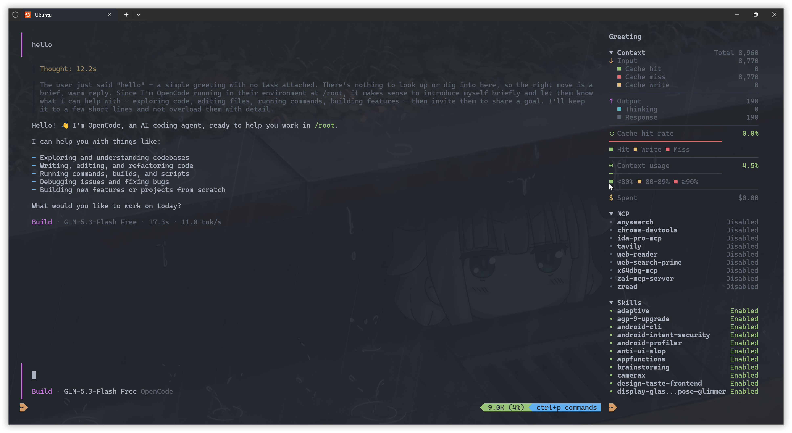

# opencode-tui-extras

[English](README.md) | [简体中文](README.zh-CN.md)

面向 OpenCode v2 的 TUI 增强插件，提供 Context、Skills 和 MCP 侧边栏、透明界面、Powerline 风格的输入框与侧边栏状态栏，以及 Open in VS Code 操作。

<p align="center">
  
</p>

## 功能

- 集成于 OpenCode v2 TUI 的 Context、Skills 和 MCP 侧边栏
- 可选透明界面，自动跟随当前主题及浅色/深色模式
- 可选的主题自适应 Powerline 风格输入框和侧边栏状态栏
- 可选在工作目录菜单中增加 `Open in VS Code`
- 显示最近一条规范化 Token 总量大于零的助手消息，并遵循压缩和 revert 边界
- 分别显示输入、缓存命中、缓存未命中和缓存写入用量
- 分别显示输出、思考和响应内容用量
- 显示缓存命中率和彩色分布条
- 使用绿色、黄色和红色阈值显示上下文窗口用量
- 显示会话累计费用，与 OpenCode 内置 Context 面板的行为一致
- Context 明细可折叠，折叠标题显示当前使用百分比
- 分隔线宽度随侧边栏可用宽度动态调整
- MCP 的 `Connected` 状态显示为绿色，管理弹窗仍使用 OpenCode 原版
- 可搜索的 Skills 管理弹窗，按项目持久保存启用/禁用状态

只要提供商通过 OpenCode 标准字段报告 token 用量，此插件即可正常工作。

## 安装

要求 OpenCode v2.0.26 或更高版本。

### CLI/TUI（`cli.json`）

在全局 CLI 配置中添加 TUI 插件：设置了 `XDG_CONFIG_HOME` 时使用 `$XDG_CONFIG_HOME/opencode/cli.json`，否则使用 `~/.config/opencode/cli.json`。

```json
{
  "plugins": [
    "-opencode.sidebar.context",
    "-opencode.sidebar.mcp",
    {
      "package": "opencode-tui-extras",
      "options": {
        "context": true,
        "sidebarScrollbar": false,
        "transparent": true,
        "mcp": true,
        "skills": true,
        "powerline": true,
        "vscode": true
      }
    }
  ]
}
```

示例启用了自定义 Context 和 MCP Sidebar，因此前两项使用 `-` 禁用 OpenCode 内置版本。当 `context` 为 `false` 时无需添加 `-opencode.sidebar.context`；当 `mcp` 为 `false` 时无需添加 `-opencode.sidebar.mcp`。

`context` 和 `sidebarScrollbar` 是相互独立且仅作用于 CLI/TUI 的选项。两者同时设为 `false` 时，自定义 Context 区域不会加载，右侧 Sidebar 滚动条仍会隐藏。

### Skills Server（`opencode.json(c)`）

在 `cli.json` 中启用 `skills` 时，还需要在 Server 配置中加载同一个包并设置 `skills: true`。可以写入全局 `~/.config/opencode/opencode.json(c)`，也可以写入项目级 `opencode.json(c)`：

```jsonc
{
  "plugins": [
    {
      "package": "opencode-tui-extras",
      "options": {
        "skills": true
      }
    }
  ]
}
```

Server 负责过滤 Skill catalog、提供管理 RPC，并按项目保存禁用的 Skill ID；CLI/TUI 负责渲染 Sidebar 和 Dialog。连接远程 Server 时，应在远端配置 Server 插件，并在本地 `cli.json` 中保留 CLI/TUI 插件。

修改任一配置文件后重启 OpenCode。

## 选项

Context 区域和 Sidebar 滚动条默认显示，其余可选增强默认关闭。

| 选项 | 默认值 | 行为 |
| --- | --- | --- |
| `context` | `true` | 显示 Context 用量区域；设为 `false` 时不加载该区域 |
| `sidebarScrollbar` | `true` | 显示右侧 Sidebar 的垂直滚动条；设为 `false` 时隐藏滚动条，但保留鼠标滚轮、触控板和键盘滚动 |
| `transparent` | `false` | 清除部分当前主题背景色，使模态弹窗周围透明暗化，并跟随主题及浅色/深色模式切换 |
| `mcp` | `false` | 添加自定义 MCP 状态侧边栏；需要禁用内置 MCP Sidebar 以免重复 |
| `skills` | `false` | 添加紧凑的 Skills Sidebar 和 `/skills-settings` 管理弹窗；Server 插件按项目保存禁用 ID |
| `powerline` | `false` | 为输入框和 Sidebar 状态栏应用跟随主题的 Powerline 配色及分隔符 |
| `vscode` | `false` | 点击输入框或 Sidebar 路径时，在工作目录菜单中增加 `Open in VS Code` |

### Context 交互

点击 `Context` 标题可折叠或展开明细。折叠标题会显示计算出的上下文窗口使用百分比。当没有符合条件的 Token 用量，或所选消息没有有效的正数上下文上限时，显示 `0.0%`。低于 80% 为绿色，80%（含）至 90%（不含）为黄色，90% 及以上为红色。

插件会选择最近一次已完成压缩之后、包含 Token 用量的最新助手消息，并遵循当前 revert 边界。

### MCP 行为

可选的 MCP Sidebar 只修改侧边栏呈现：`Connected` 文本使用与状态小点相同的主题 success 颜色。服务器超过两个时，点击 `MCP` 标题可折叠或展开列表；折叠标题会汇总 connected 和 issue 数量。issue 数量包含连接失败以及需要认证的服务器。

点击服务器会调用 OpenCode 原生 `mcp.list` 命令。原生选择命令可用时，插件会将对话框选中项移动到被点击的服务器；不可用时则保留原生默认选中项。连接、断开、重试、认证、错误详情、原生 Space 键操作和实时状态更新均继续由 OpenCode 管理。

### Skills 管理

可选的 Skills Sidebar 与原生 MCP Sidebar 行为一致：展开时显示全部 Skills，折叠时显示状态汇总。点击某一行或运行 `/skills-settings` 可打开搜索管理弹窗；选中项目即可在启用与禁用之间切换。`Manual` 表示该 Skill 设置了 `autoinvoke: false`：仍可手动调用，但不会自动展示给模型。

禁用的 Skill ID 由 Server 插件按 OpenCode 项目保存，重启 Server 或 TUI 后仍然有效。插件只从 OpenCode Skill registry 中过滤对应项目，不会修改或移动原始 `SKILL.md`；重新启用时会恢复底层 Skill。状态变化后，TUI 会刷新 OpenCode 原生 Skill 缓存，因此运行中的客户端会立即更新 `/skills` 和 `@skill` 补全。

OpenCode 分两个阶段提供 Skill。激活之前，模型只能看到已启用且允许自动调用的 Skill 的 `id`、`name` 和 `description`；已启用的 `Manual` Skill 仍可通过 `/skills` 或 `@skill` 显式选择。在现有 Session 中启用 Skill，会从下一次模型请求开始恢复可用，但启用操作本身不会注入指令。只有模型调用 Skill 工具或用户显式附加 Skill 时，OpenCode 才会把 `SKILL.md` 的 Markdown 正文展开为 `<skill_content>`，并将这段文本保存到 Session。Skill 目录中的其他文件内容不会自动上传；OpenCode 只会附带抽样后的文件路径列表，供后续按需读取。

这个开关控制的是后续加载，不会修改已经物化的历史内容：

| 场景 | 行为 |
| --- | --- |
| 当前 Session 尚未加载 Skill 时禁用 | 立即生效；后续请求无法再自动或显式加载 |
| 当前 Session 已加载 Skill 后禁用 | 阻止后续加载，但此前注入的文本仍保留在该 Session 历史中 |
| 断开后重新打开同一个 Session | 恢复同一份持久化历史，包括此前注入的 Skill 文本 |
| Skill 禁用时新建 Session | 新 Session 不包含该 Skill，也无法加载它 |
| 在现有 Session 中启用 | 下一次请求即可发现；只有随后真正调用 Skill 时才会注入完整正文 |

修改状态无法改变已经在执行中的模型请求。上下文压缩也不能保证卸载：Skill 文本可能原样保留在近期窗口中，也可能进入生成的摘要。当前 OpenCode API 尚不支持 Session 级 Skill 卸载，因此如需确保上下文中完全不存在此前加载的 Skill 文本，应新建 Session。

### 透明模式

透明模式应搭配原始主题使用（例如使用 `one-dark`，而不是透明主题副本）。插件会清除部分基础及凸起背景色，通常会使主界面、Sidebar、输入框和工具区域透明。当前景色相对终端检测到的背景仍然清晰时会保持不变；低对比度文字会向终端前景色调整。插件也会移除与输入框阴影颜色匹配的连续长条，并自动跟随主题及浅色/深色模式切换。打开模态弹窗时，只有弹窗面板保留主题的不透明表面，周围界面在同一渲染帧中保持透明并暗化。底层图片以及能够安全识别的原生边框和输入框阴影会暂时隐藏；CJK 文字、Emoji 等 tagged OpenTUI 字形始终保留。

### Powerline 模式

Powerline 模式保留 OpenCode 现有状态栏的内容、布局、响应式行为和点击操作，只为输入框和 Sidebar 状态栏应用主题衍生的前景色、背景色和 Powerline 分隔符。路径、活动状态、Context、费用和命令提示会自动跟随主题及浅色/深色模式切换。Context 继续使用与 Context 面板一致的绿色、黄色和红色阈值。

如果 `` 或 `` 显示异常，请为终端配置兼容 Powerline 的字体或 Nerd Font。打开模态弹窗时会暂停 Powerline 着色，使弹窗与底层界面保持清晰区隔。

### VS Code 操作

启用 `vscode` 后，点击工作目录路径会打开增强后的原生菜单，其中新增 `Open in VS Code`。该操作执行 `code --reuse-window <目录>`，因此运行 OpenCode TUI 的环境需要能够找到 `code` 命令。复制路径、系统文件管理器和 Workspaces 操作仍然保留。

## 工作原理

插件使用 OpenCode 已经标准化的数据，不会直接调用各模型提供商的 API。

```text
模型提供商响应
  -> OpenCode 标准化 Token 用量
  -> 插件选择最近一条符合条件的助手消息
  -> 侧边栏计算并显示用量明细
```

| 界面项目 | OpenCode 字段 | 含义 |
| --- | --- | --- |
| Cache miss | `tokens.input` | 未读取缓存、也未写入缓存的普通输入 |
| Cache hit | `tokens.cache.read` | 从缓存复用的输入 |
| Cache write | `tokens.cache.write` | 写入缓存、供后续请求使用的输入 |
| Response | `tokens.output` | 不含思考过程的模型输出 |
| Thinking | `tokens.reasoning` | 模型报告的思考 Token |

界面中的统计值按以下方式计算：

```text
Input         = Cache miss + Cache hit + Cache write
Output        = Response + Thinking
Total         = Input + Output
Cache hit rate = Cache hit / Input * 100%（Input 为零时取 0%）
Context usage = Total / 模型上下文上限 * 100%
```

缓存分布条按 Cache hit、Cache write 和 Cache miss 的比例划分 `Input`。上下文上限根据所选助手消息中记录的提供商和模型查找，而不是使用输入框当前选择的模型。费用直接使用 OpenCode 累计的 `session.cost`，不同提供商的 Token 价格仍由 OpenCode 处理。缺失或无效的数据会显示为零，不会出现 `NaN`。由于数据来自当前会话状态，每次产生新的助手消息后，侧边栏都会随之更新。

## 从源码开发

克隆仓库后安装依赖并构建。发布到 npm 的包只包含生成的 `dist` 文件，不包含源码和构建脚本。

```bash
npm install
npm run build
```

仅加载本地 TUI 功能时，先构建项目，再在 `~/.config/opencode/cli.json` 中指向生成的 `dist` 目录。仅在启用 `mcp` 选项时添加 `-opencode.sidebar.mcp`：

```json
{
  "plugins": [
    "-opencode.sidebar.context",
    {
      "package": "file:///absolute/path/to/opencode-tui-extras/dist",
      "options": {
        "context": true,
        "sidebarScrollbar": false,
        "transparent": true,
        "mcp": false,
        "powerline": true,
        "vscode": true
      }
    }
  ]
}
```

如需从源码测试 Skills 管理，应在 `cli.json` 中保留上面的 `dist` 目录，同时也从 Server 配置加载它：

```jsonc
{
  "plugins": [
    {
      "package": "file:///absolute/path/to/opencode-tui-extras/dist",
      "options": { "skills": true }
    }
  ]
}
```

## 许可证

MIT
